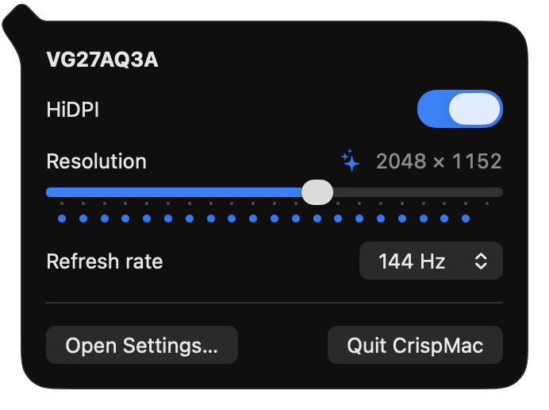
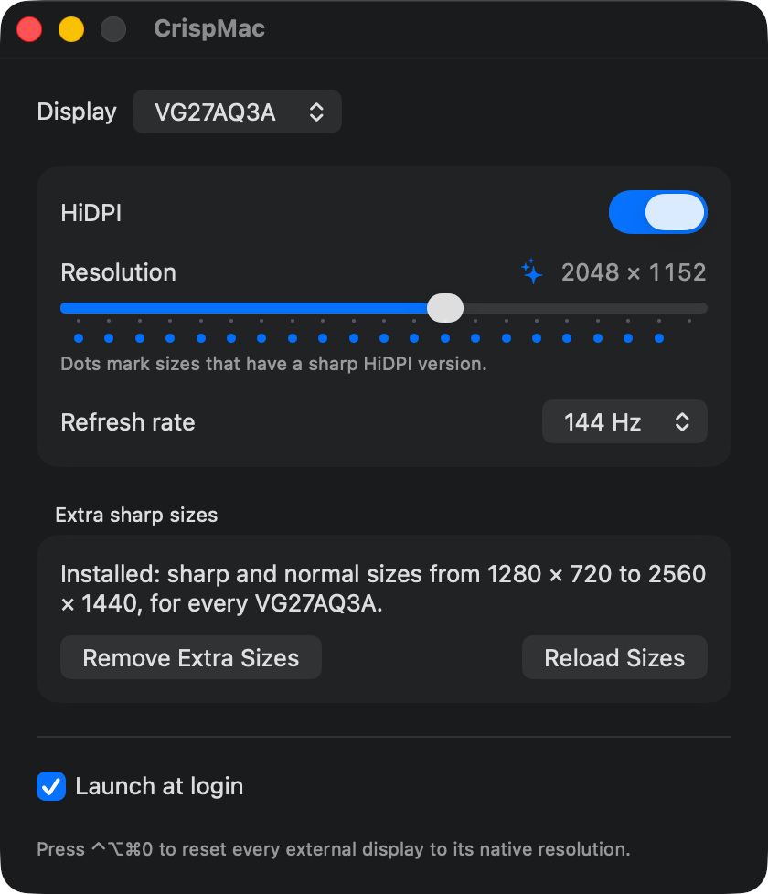

# CrispMac

Make external monitors look sharp on Apple Silicon Macs.

On a non-Retina external display such as a 27" 1440p monitor, macOS draws everything at 1×
and text looks soft. CrispMac switches the display to a **HiDPI** mode: the desktop is drawn
at twice the size it looks like, then scaled down to the panel. "Looks like 2048 × 1152" on a
2560 × 1440 monitor is drawn at 4096 × 2304, and everything gets noticeably crisper.

That's all it does:

- **HiDPI** on or off
- **Resolution** slider (dots mark the sizes with a sharp version)
- **Refresh rate** picker, so you keep 144 Hz
- **Extra sharp sizes**: one click adds 21 sizes for your monitor, no reboot
- Settings per monitor, re-applied at login, on wake and when you plug in
- "Keep this display setting?" after every change, reverting by itself after 10 seconds
- **⌃⌥⌘0** resets every external display to its native resolution, even if you can't see anything

It lives in the menu bar and has a small settings window.

<p>
  
  
</p>

## Requirements

- Apple Silicon Mac, macOS 14 or later
- Swift command line tools (`xcode-select --install`); Xcode is not required

## Download

Grab `CrispMac-<version>.zip` from [Releases](https://github.com/kyousri/CrispMac/releases),
unzip it and move `CrispMac.app` to `/Applications`.

CrispMac isn't notarized by Apple, so macOS blocks it the first time. Try to open it, then go
to **System Settings → Privacy & Security** and click **Open Anyway**. Or, in Terminal:

```sh
xattr -dr com.apple.quarantine /Applications/CrispMac.app
```

## Build and install

```sh
./scripts/build-app.sh
cp -R build/CrispMac.app /Applications/
open /Applications/CrispMac.app
```

Move the app to `/Applications` before the first launch: the first launch turns on launch at
login for wherever the app is.

If you also run BetterDisplay or a similar tool, quit it: two apps changing display modes
will fight each other.

## Where's the icon?

macOS 26 hides menu bar icons that don't fit, especially next to the notch. If you don't see
CrispMac, allow it in **System Settings → Menu Bar**, or open the app again from Finder to
get the settings window.

## Extra sharp sizes

On its own, macOS offers almost no sharp sizes for a 1440p monitor: 1280 × 720 and below,
which makes everything huge. In the settings window, **Add More Sharp Sizes** installs a
display override for your monitor model with 21 sizes from half its width up to native
(1280 × 720 to 2560 × 1440 on a 1440p monitor), each sharp and normal, at your monitor's
refresh rates.

- It asks for your password once (the standard macOS prompt). Nothing keeps running in the
  background with admin rights.
- Your external displays go black for a few seconds while CrispMac turns them off and on so
  macOS loads the new sizes. No reboot.
- **Remove Extra Sizes** undoes it and restores any override another tool had installed.
- If macOS ever forgets the sizes after sleep or a replug, the menu bar icon shows a warning
  and **Reload Sizes** brings them back.

To see what your display offers:

```sh
/Applications/CrispMac.app/Contents/MacOS/CrispMac --list
```

## Uninstall

1. In the settings window, click **Remove Extra Sizes** for each monitor you added them to.
   This deletes the override from `/Library/Displays` and restores any override it replaced.
2. Quit CrispMac and drag it from `/Applications` to the Trash. macOS removes its login item.
3. Optionally, delete its settings: `defaults delete com.kyousri.crispmac`

## Development

```sh
./scripts/test.sh                  # unit tests (Swift Testing)
./scripts/build-app.sh debug       # debug build of the app
./scripts/release.sh 1.0.0         # build, zip and publish a GitHub release
```

The app binary has a few command-line helpers that use the same code as the buttons:

```sh
CrispMac --list                     # modes per display, extra sizes status
CrispMac --reload                   # turn external displays off and on
sudo sh -c "$(CrispMac --print-install-command)"   # what "Add More Sharp Sizes" runs
sudo sh -c "$(CrispMac --print-remove-command)"    # what "Remove Extra Sizes" runs
```

The display logic lives in `Sources/CrispCore` and is tested without touching real displays.
`Sources/CrispMac` is the app. See [docs/design.md](docs/design.md) for how it works and why.

## Caveats

Switching modes uses public macOS APIs. Loading extra sizes without a reboot uses an
undocumented one, which a macOS update can break; unplugging and replugging the monitor
does the same job. It's a personal tool shared as is.

## Credits

BetterDisplay showed what's possible. [Acuity](https://github.com/paulhkang94/acuity) and
Apple's own display overrides in `/System/Library/Displays` confirmed the override format
that works on Apple Silicon.

## License

MIT
